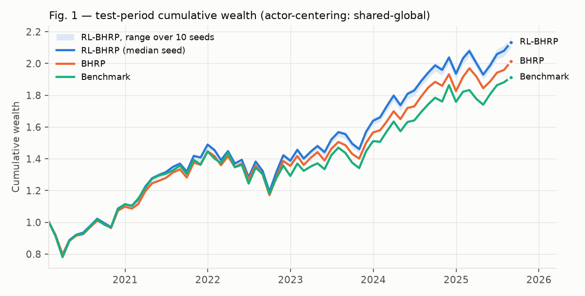
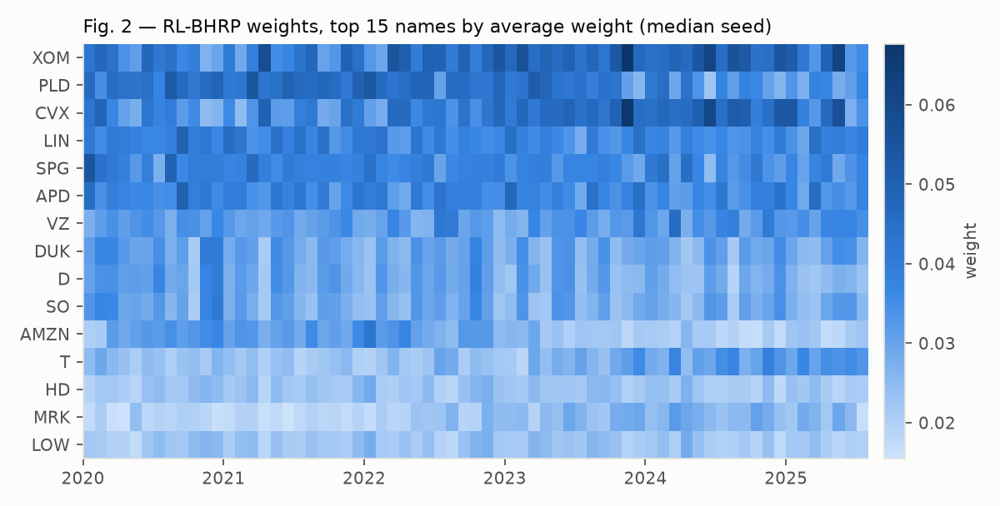
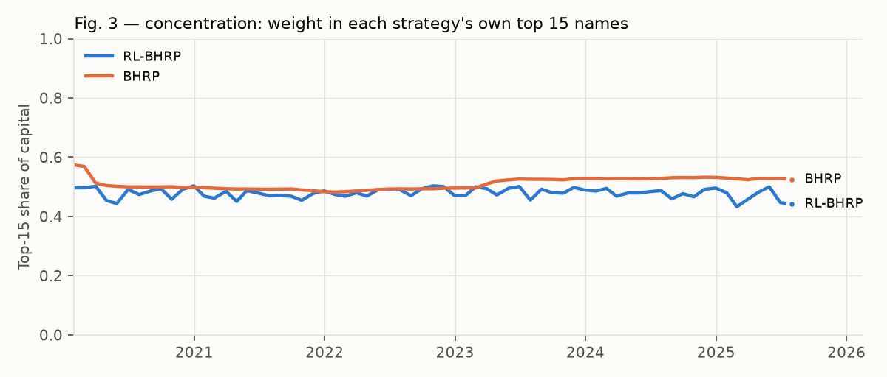

# RL-BHRP: Reinforcement-Learning-Embedded Bayesian Hierarchical Risk Parity

Code for

> Shaofeng Kang and Zeying Tian. **Optimal Portfolio Construction — A Reinforcement Learning Embedded Bayesian
> Hierarchical Risk Parity (RL-BHRP) Approach.** arXiv:2508.11856, 2025.
> [[paper]](https://arxiv.org/abs/2508.11856)

RL-BHRP is a two-level portfolio allocator. It splits risk equally across sectors and equally within each sector,
starting from Bayesian-shrunk inputs. A policy-gradient agent then tilts those budgets as market conditions change,
under an explicit transaction-cost model and a risk-parity penalty.

<p align="center"></p>

## Contents

- [Method](#method)
- [Results](#results)
- [Installation](#installation)
- [Reproducing the results](#reproducing-the-results)
- [Implementation details](#implementation-details)
- [Repository structure](#repository-structure)
- [Citation](#citation)

## Method

The model has three layers, each mapped to code:

1. **Bayesian hierarchical layer** (paper Sec. 3.1, Alg. 3 → `bhrp.posterior`). Each month-end, the code estimates
   per-asset means and variances on a rolling 3-year window of daily returns. It shrinks each asset's mean toward its
   sector mean with a normal–normal update, and estimates the covariance with Ledoit–Wolf.
2. **Two-level risk parity, BHRP** (Sec. 3.1.7–3.1.11, Alg. 1/2/5 → `bhrp.bhrp`, `bhrp.risk_budget`). Asset weights
   factor as w_i = W_g(i) · η_i|g, sector weights times within-sector weights. A fixed-point iteration makes risk
   contributions equal across sectors (log-domain Newton on the composite sector covariance) and equal within each
   sector. The resulting portfolio is exactly risk budgeting with b_i = 1 / (G · n_g(i)); `test_bhrp.py` checks this.
3. **RL layer** (Sec. 3.2, Alg. 4 → `rl.py`). This is an MDP on the monthly rebalance grid:
   - **State:** 3 lagged monthly returns, the posterior mean, the posterior volatility, and the previous weights.
   - **Action:** a factorized softmax over sector logits Ψ_g and within-sector logits Φ_i|g. The actor outputs
     residuals added to BHRP's own logits, so a zero action reproduces BHRP.
   - **Reward:** eq. (4), U = wᵀR − c‖w_t − w_t−1‖₁ − λ[α V_within + (1−α) V_across], where the V terms measure the
     dispersion of risk contributions.
   - **Training:** PPO with average-reward generalized advantage estimation, on 2015–2019.
   - **Evaluation:** out of sample, Feb 2020 – Aug 2025, using the mean action.

Universe: the 48 large caps of Table 1 across the 11 GICS sectors. The benchmark is an equal-weight portfolio of the
11 SPDR sector ETFs, rebalanced monthly. Costs are 5 bps one-way.

## Results

Test period Feb 2020 – Aug 2025 (67 monthly periods). RL-BHRP numbers are means over 10 training seeds.
"Shared" and "flat" are two actor architectures (see [Implementation details](#implementation-details)); the
penalty is as written in Def. 3.2.3.

| Metric | RL-BHRP shared | RL-BHRP flat | BHRP | Benchmark | Paper RL-BHRP | Paper BHRP | Paper Benchmark |
|---|---:|---:|---:|---:|---:|---:|---:|
| Total Cumulative Return | 113.49% | 111.11% | 101.38% | 91.41% | 119.96% | 101.37% | 91.41% |
| CAGR | **14.55%** | 14.30% | 13.36% | 12.33% | 15.16% | 13.36% | 12.33% |
| Annual Return (Mean ×12) | 15.10% | 14.89% | 13.97% | 13.19% | 15.72% | 13.97% | 13.19% |
| Annual Volatility | 16.95% | 17.00% | 16.51% | 17.28% | 17.37% | 16.52% | 17.28% |
| Sharpe | **0.891** | 0.876 | 0.846 | 0.763 | 0.905 | 0.846 | 0.763 |
| Sortino | 1.640 | 1.606 | 1.535 | 1.368 | 1.648 | 1.535 | 1.368 |
| Max Drawdown | -19.71% | -19.31% | -19.12% | -18.32% | -20.33% | -19.10% | -18.32% |
| Calmar | 0.738 | 0.746 | 0.699 | 0.673 | 0.746 | 0.699 | 0.673 |
| Tracking Error | 3.29% | 5.07% | 3.58% | 0.00% | 3.69% | 3.58% | 0.00% |
| Information Ratio | 0.582 | 0.329 | 0.220 | — | 0.687 | 0.220 | — |
| Beta | 0.963 | 0.941 | 0.935 | 1.000 | 0.983 | 0.935 | 1.000 |
| Jensen Alpha | 2.41% | 2.49% | 1.64% | 0.00% | 2.76% | 1.64% | 0.00% |
| VaR 5% (period) | -7.18% | -6.72% | -6.72% | -8.00% | -7.41% | -6.72% | -7.99% |
| CVaR 5% (period) | -9.85% | -9.62% | -9.70% | -10.34% | -10.24% | -9.70% | -10.34% |
| Hit Rate (>0) | 64.18% | 65.22% | 64.18% | 62.69% | 64.18% | 64.18% | 62.69% |
| Max Drawdown (standard)† | -20.43% | -20.61% | -20.53% | -21.93% | — | — | — |
| Sortino (standard)† | 1.434 | 1.411 | 1.342 | 1.196 | — | — | — |

† Conventional definitions; the rows above them use Table 2's conventions (see [Metric conventions](#metric-conventions)).

- **Benchmark and BHRP reproduce Table 2.** The match holds on every metric: BHRP to within 6e-4, the Benchmark to
  within 1e-6. The one exception is the Benchmark VaR, where the table's -0.079889 is a typo for the -0.079989 its
  text quotes as -8.00%.
- **RL-BHRP improves on BHRP on every seed with the shared actor.** Across seeds, CAGR ranges 14.23–14.88%, Sharpe
  0.873–0.904 and IR 0.49–0.68, while tracking error is lower than BHRP's. That is +1.2 pp CAGR and +0.045 Sharpe,
  against the paper's +1.8 pp and +0.059. The flat actor also improves on average (9/10 seeds on CAGR), but it is
  noisier: CAGR ranges 13.15–15.80% and TE 4.6–5.8%.
- **The paper's RL-BHRP column is not reproduced exactly.** Unfortunately, the training seed of the original run was
  lost, along with the RL settings the paper does not report (λ, α, iteration count, actor architecture). The
  RL-BHRP numbers here are the best reproduction we obtained. They match the paper's direction and most of its size,
  but not its exact values.
- **Interpretation.** All seeds are evaluated on the same 67-month path. The consistency across seeds therefore shows
  robustness to training randomness, not statistical significance. An IR of 0.58 over 5.6 years is t ≈ 1.4; the
  paper's 0.687 is t ≈ 1.6.

The within-sector reading of the penalty (`--centering sector`) gives nearly identical results: shared 14.54% / 0.890,
flat 13.62% / 0.848.

<p align="center">


</p>

**Weights.** The shared-actor policy makes slow, structured tilts around BHRP:
- **Turnover:** 0.14 per month on average, against 0.014 for BHRP.
- **Persistence:** month-to-month cosine similarity is 0.98.
- **Concentration:** the top-15 names hold 48% of capital, within a range of 43–50%.
- **Names:** 12 of its top 15 names coincide with those in the paper's Fig. 2.

The paper reports noisier weight paths (turnover 0.60, cosine 0.74), which are closer to what the flat actor produces
(0.40, 0.87).

### Robustness

`sensitivity.py` trains 640 policies: 2 actors × 2 penalty centerings × λ ∈ {1e5, 1e6, 1e7, 1e8} × 10 seeds,
checkpointed at 25, 50, 100 and 200 iterations. It scores every test-period outcome, and is a report, not a selection
step. The tables show the global penalty: CAGR mean over seeds, with the number of seeds beating BHRP's 13.36% in
parentheses.

**Shared actor**

| λ \ iterations | 25 | 50 | 100 | 200 |
|---|---:|---:|---:|---:|
| 1e5 | 13.52% (10/10) | 13.70% (10/10) | 14.06% (10/10) | 14.96% (10/10) |
| 1e6 | 13.50% (10/10) | 13.66% (10/10) | 13.89% (10/10) | 14.29% (10/10) |
| 1e7 | 13.43% (7/10) | 13.46% (9/10) | 13.48% (10/10) | 13.56% (10/10) |
| 1e8 | 13.33% (4/10) | 13.30% (1/10) | 13.26% (0/10) | 13.30% (0/10) |

**Flat actor**

| λ \ iterations | 25 | 50 | 100 | 200 |
|---|---:|---:|---:|---:|
| 1e5 | 13.47% (9/10) | 13.65% (8/10) | 14.30% (9/10) | 17.40% (10/10) |
| 1e6 | 13.50% (9/10) | 13.60% (8/10) | 13.74% (7/10) | 13.85% (6/10) |
| 1e7 | 13.36% (5/10) | 13.36% (5/10) | 13.21% (2/10) | 13.24% (4/10) |
| 1e8 | 13.33% (5/10) | 13.25% (2/10) | 13.31% (3/10) | 13.34% (5/10) |

λ sets how far the policy may move from BHRP: at 1e8 the penalty pins it to BHRP. With the shared actor, any λ that
lets it move gives a gain on every seed, and the gain grows with training. The flat actor's large gains at λ = 1e5
come with seed sd up to 2.9 pp and tracking error up to 9%.

## Installation

Requires Python ≥ 3.11 and [uv](https://docs.astral.sh/uv/).

```sh
git clone https://github.com/IngTian/rl-bhrp.git
cd rl-bhrp
uv sync
```

Dependencies: numpy, pandas, scikit-learn (Ledoit–Wolf), PyTorch (PPO, CPU is enough), yfinance, matplotlib.

## Reproducing the results

Every step reads from or writes to `data/` (cache, not committed) and `results/`. Timings are for a 14-core laptop;
the training scripts use 12 worker processes.

```sh
# 0. Numerical checks of the paper's propositions (seconds)
uv run python test_bhrp.py

# 1. Download prices from Yahoo Finance into data/yahoo.pkl (2012-01-01 .. 2025-08-13, ~1 min)
uv run python data.py

# 2. Build the monthly decision panel: posterior, covariance, BHRP weights (~1 min)
uv run python panel.py

# 3. Tune λ and the iteration count on 2017-12..2019-11, train 10 seeds on 2015-2019, test 2020-02..2025-08 (~1 min each)
uv run python run.py --actor shared --centering global
uv run python run.py --actor flat   --centering global
uv run python run.py --actor shared --centering sector
uv run python run.py --actor flat   --centering sector

# 4. Figures 1-3 for a run
uv run python plots.py shared-global

# 5. Robustness grid (640 policies, a few minutes)
uv run python sensitivity.py
```

Steps 1–2 run automatically if their caches are missing. `run.py` prints the validation grid, the Table 2 comparison
and the weight diagnostics. It writes to `results/<actor>-<centering>/`:

| file | contents |
|---|---|
| `table2.csv` | Table 2 metrics: RL-BHRP seed mean / min / max, BHRP, Benchmark, and the paper's three columns |
| `seeds.csv` | Table 2 metrics for each seed |
| `validation.csv` | validation Sharpe for each (λ, iterations, seed) |
| `returns.csv` | monthly net returns: each seed, BHRP, Benchmark |
| `weights.npz` | monthly weights: each seed and BHRP |
| `summary.json` | selected λ and iterations, median seed, Sec. 4.2 diagnostics |
| `fig1_wealth.png`, `fig2_heatmap.png`, `fig3_top15_share.png` | Figures 1–3 |

Yahoo occasionally revises adjusted prices retroactively, so a fresh download can move the numbers slightly.

## Implementation details

The paper does not specify some settings. Values marked * were recovered by matching the paper's Table 2.

| Setting | Value |
|---|---|
| Rolling window W_t | 756 trading days* (252 or 504 do not reproduce BHRP) |
| Daily → monthly scaling | moments × 21 |
| Prior sd of an asset's mean around its sector mean (τ) | 0.1% per day |
| Lagged returns in the state (k) | 3 |
| Transaction cost c | 5 bps one-way, on ‖w_t − w_t−1‖₁ of target weights; BHRP pays it too, the benchmark does not |
| Penalty split α | 0.5 |
| Penalty weight λ, iterations | chosen from {1e5, 1e6, 1e7, 1e8} × {25, 50, 100, 200, 300} by mean validation Sharpe (3 seeds, last 24 training months) |
| PPO | 16 rollouts/iteration, 10 epochs × 4 minibatches, Adam lr 3e-4, clip 0.2, entropy 1e-3, GAE λ 0.95, initial logit sd 0.3 |
| Seeds | 10 (final), 3 (tuning) |

**Actors.** Both actors output residual logits added to BHRP's logits and are zero-initialised, so training starts
exactly at BHRP. The stochastic policy is a diagonal Gaussian over the G + N logits.
- `flat` is an MLP over the whole state (29.6k parameters). With 59 training months, it can learn to recognise
  individual dates.
- `shared` is one small MLP applied to each asset's own row of the state (434 parameters). Its first output is
  Φ_i|g; its second output, averaged over each sector's names, is Ψ_g.

**Penalty centering.** Def. 3.2.3 centres the asset-level risk contributions over all N assets
(`--centering global`, the default). Alg. 1's RCVAR_within instead centres them within each sector
(`--centering sector`), and only that version is exactly zero at BHRP when sectors have different sizes. The two
give nearly identical results.

**Solvers.**
- The within-sector update of Alg. 1 is damped to η ← √(η/m), which has the same fixed point as η ← 1/m. The literal
  update alternates between two points on a block-diagonal Σ; on these covariances both versions converge to the same
  weights.
- The sector step uses the log-Newton method of Alg. 2. Its starting point y = 0 requires Σ·1 > 0, which holds for
  these equity covariances.

**Tradable universe.** The quarterly screen (20-day ADV ≥ $10M, price ≥ $3) uses raw closes reconstructed from split
history, because Yahoo's closes are split-adjusted. It is set at each quarter-end and held for the next quarter. All
48 names pass throughout the test period.

### Metric conventions

These conventions were recovered by matching the paper's Benchmark column exactly:
- Returns are monthly, rf = 0, annualised with 12 periods.
- Volatility and tracking error use the population standard deviation.
- Drawdown peaks are taken from the first month-end, so the Feb-2020 loss is not counted. The standard drawdown,
  measured from the starting wealth of 1.0, is reported in an extra row.
- The Sortino denominator is std(min(r, 0)). The standard downside deviation, √mean(min(r, 0)²), is reported in an
  extra row.

## Repository structure

| file | contents | paper |
|---|---|---|
| `data.py` | universe, Yahoo download, quarterly tradability screen | Table 1, Def. 3.1.1 |
| `bhrp.py` | posterior, risk contributions, penalty, risk budgeting, two-level fixed point, factorized softmax | Sec. 3.1, Alg. 1–3, 5, Def. 3.2.3–3.2.4 |
| `panel.py` | monthly decision panel | Sec. 3.2 (timing) |
| `rl.py` | environment, actors, average-reward PPO | Sec. 3.2, Alg. 4 |
| `run.py` | tuning, multi-seed training, backtest, Table 2 metrics, Sec. 4.2 diagnostics | Sec. 4 |
| `plots.py` | Figures 1–3 | Figs. 1–3 |
| `sensitivity.py` | robustness grid | — |
| `test_bhrp.py` | checks of Prop. 3.1.8, Lemma 3.1.10, Thm. 3.1.11, App. A, eqs. 3.2.5 and 3.2.7, and Alg. 1 = risk budgeting | Sec. 3, App. A |

## Citation

```bibtex
@article{kang2025rlbhrp,
  title   = {Optimal Portfolio Construction -- A Reinforcement Learning Embedded Bayesian Hierarchical Risk Parity (RL-BHRP) Approach},
  author  = {Kang, Shaofeng and Tian, Zeying},
  journal = {arXiv preprint arXiv:2508.11856},
  year    = {2025}
}
```

## License

[MIT](LICENSE)
