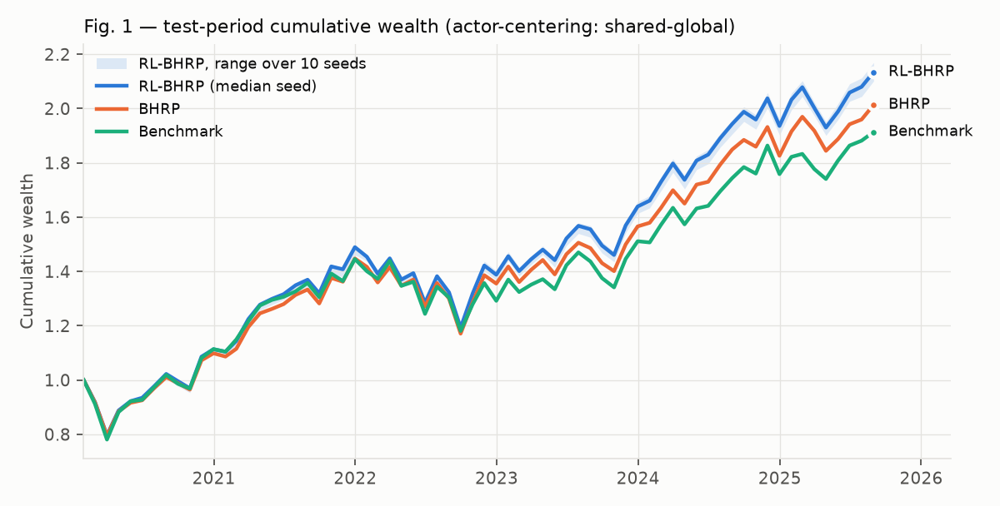
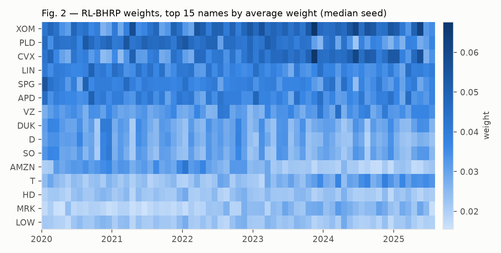
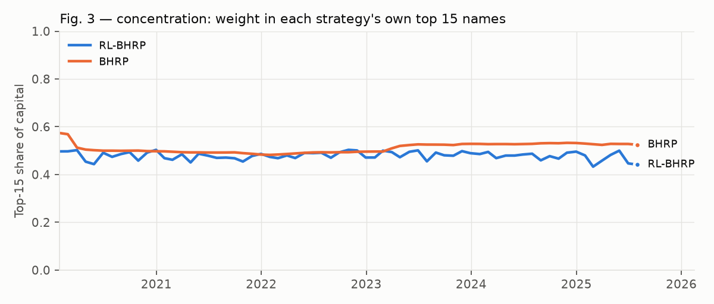
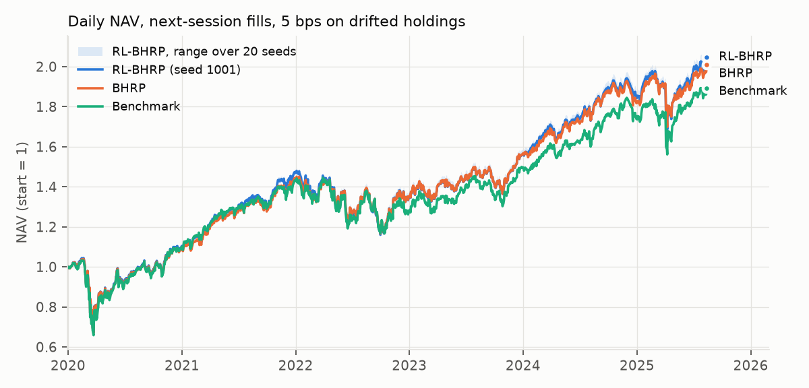
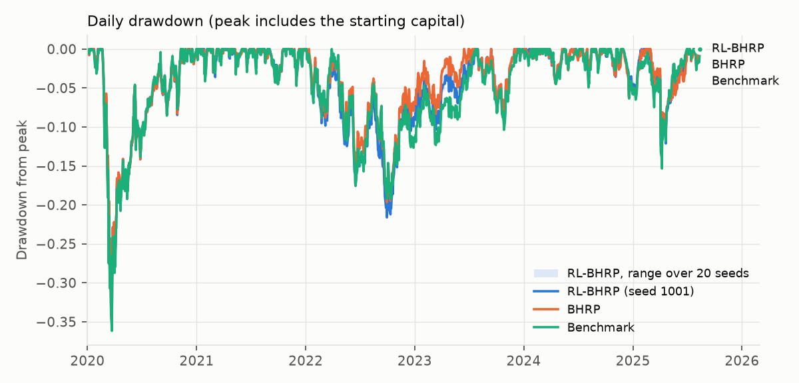

# RL-BHRP: Reinforcement-Learning-Embedded Bayesian Hierarchical Risk Parity

Code for

> Shaofeng Kang and Zeying Tian. **Optimal Portfolio Construction — A Reinforcement Learning Embedded Bayesian
> Hierarchical Risk Parity (RL-BHRP) Approach.** arXiv:2508.11856, 2025.
> [[paper]](https://arxiv.org/abs/2508.11856)

RL-BHRP is a two-level portfolio allocator. It splits risk equally across sectors and equally within each sector,
starting from Bayesian-shrunk inputs. A policy-gradient agent then tilts those budgets as market conditions change,
under an explicit transaction-cost model and a risk-parity penalty.

<p align="center"></p>

## Contents

- [Method](#method)
- [Results](#results)
- [Installation](#installation)
- [Reproducing the results](#reproducing-the-results)
- [Implementation details](#implementation-details)
- [Repository structure](#repository-structure)
- [Research lane (issue #3)](#research-lane-issue-3)
- [Citation](#citation)

## Method

The model has three layers, each mapped to code:

1. **Bayesian hierarchical layer** (paper Sec. 3.1, Alg. 3 → `bhrp.posterior`). Each month-end, the code estimates
   per-asset means and variances on a rolling 3-year window of daily returns. It shrinks each asset's mean toward its
   sector mean with a normal–normal update, and estimates the covariance with Ledoit–Wolf.
2. **Two-level risk parity, BHRP** (Sec. 3.1.7–3.1.11, Alg. 1/2/5 → `bhrp.bhrp`, `bhrp.risk_budget`). Asset weights
   factor as w_i = W_g(i) · η_i|g, sector weights times within-sector weights. A fixed-point iteration makes risk
   contributions equal across sectors (log-domain Newton on the composite sector covariance) and equal within each
   sector. The resulting portfolio is exactly risk budgeting with b_i = 1 / (G · n_g(i)); `test_bhrp.py` checks this.
3. **RL layer** (Sec. 3.2, Alg. 4 → `rl.py`). This is an MDP on the monthly rebalance grid:
   - **State:** 3 lagged monthly returns, the posterior mean, the posterior volatility, and the previous weights.
   - **Action:** a factorized softmax over sector logits Ψ_g and within-sector logits Φ_i|g. The actor outputs
     residuals added to BHRP's own logits, so a zero action reproduces BHRP.
   - **Reward:** eq. (4), U = wᵀR − c‖w_t − w_t−1‖₁ − λ[α V_within + (1−α) V_across], where the V terms measure the
     dispersion of risk contributions.
   - **Training:** PPO with average-reward generalized advantage estimation, on 2015–2019.
   - **Evaluation:** out of sample, Feb 2020 – Aug 2025, using the mean action.

Universe: the 48 large caps of Table 1 across the 11 GICS sectors. The benchmark is an equal-weight portfolio of the
11 SPDR sector ETFs, rebalanced monthly. Costs are 5 bps one-way.

## Results

Test period Feb 2020 – Aug 2025 (67 monthly periods). RL-BHRP numbers are means over 10 training seeds.
"Shared" and "flat" are two actor architectures (see [Implementation details](#implementation-details)); the
penalty is as written in Def. 3.2.3.

| Metric | RL-BHRP shared | RL-BHRP flat | BHRP | Benchmark | Paper RL-BHRP | Paper BHRP | Paper Benchmark |
|---|---:|---:|---:|---:|---:|---:|---:|
| Total Cumulative Return | 113.49% | 111.11% | 101.38% | 91.41% | 119.96% | 101.37% | 91.41% |
| CAGR | **14.55%** | 14.30% | 13.36% | 12.33% | 15.16% | 13.36% | 12.33% |
| Annual Return (Mean ×12) | 15.10% | 14.89% | 13.97% | 13.19% | 15.72% | 13.97% | 13.19% |
| Annual Volatility | 16.95% | 17.00% | 16.51% | 17.28% | 17.37% | 16.52% | 17.28% |
| Sharpe | **0.891** | 0.876 | 0.846 | 0.763 | 0.905 | 0.846 | 0.763 |
| Sortino | 1.640 | 1.606 | 1.535 | 1.368 | 1.648 | 1.535 | 1.368 |
| Max Drawdown | -19.71% | -19.31% | -19.12% | -18.32% | -20.33% | -19.10% | -18.32% |
| Calmar | 0.738 | 0.746 | 0.699 | 0.673 | 0.746 | 0.699 | 0.673 |
| Tracking Error | 3.29% | 5.07% | 3.58% | 0.00% | 3.69% | 3.58% | 0.00% |
| Information Ratio | 0.582 | 0.329 | 0.220 | — | 0.687 | 0.220 | — |
| Beta | 0.963 | 0.941 | 0.935 | 1.000 | 0.983 | 0.935 | 1.000 |
| Jensen Alpha | 2.41% | 2.49% | 1.64% | 0.00% | 2.76% | 1.64% | 0.00% |
| VaR 5% (period) | -7.18% | -6.72% | -6.72% | -8.00% | -7.41% | -6.72% | -7.99% |
| CVaR 5% (period) | -9.85% | -9.62% | -9.70% | -10.34% | -10.24% | -9.70% | -10.34% |
| Hit Rate (>0) | 64.18% | 65.22% | 64.18% | 62.69% | 64.18% | 64.18% | 62.69% |
| Max Drawdown (standard)† | -20.43% | -20.61% | -20.53% | -21.93% | — | — | — |
| Sortino (standard)† | 1.434 | 1.411 | 1.342 | 1.196 | — | — | — |

† Conventional definitions; the rows above them use Table 2's conventions (see [Metric conventions](#metric-conventions)).

- **Benchmark and BHRP reproduce Table 2.** The match holds on every metric: BHRP to within 6e-4, the Benchmark to
  within 1e-6. The one exception is the Benchmark VaR, where the table's -0.079889 is a typo for the -0.079989 its
  text quotes as -8.00%.
- **RL-BHRP improves on BHRP on every seed with the shared actor.** Across seeds, CAGR ranges 14.23–14.88%, Sharpe
  0.873–0.904 and IR 0.49–0.68, while tracking error is lower than BHRP's. That is +1.2 pp CAGR and +0.045 Sharpe,
  against the paper's +1.8 pp and +0.059. The flat actor also improves on average (9/10 seeds on CAGR), but it is
  noisier: CAGR ranges 13.15–15.80% and TE 4.6–5.8%.
- **The paper's RL-BHRP column is not reproduced exactly.** Unfortunately, the training seed of the original run was
  lost, along with the RL settings the paper does not report (λ, α, iteration count, actor architecture). The
  RL-BHRP numbers here are the best reproduction we obtained. They match the paper's direction and most of its size,
  but not its exact values.
- **Interpretation.** All seeds are evaluated on the same 67-month path. The consistency across seeds therefore shows
  robustness to training randomness, not statistical significance. An IR of 0.58 over 5.6 years is t ≈ 1.4; the
  paper's 0.687 is t ≈ 1.6.

The within-sector reading of the penalty (`--centering sector`) gives nearly identical results: shared 14.54% / 0.890,
flat 13.62% / 0.848.

<p align="center">


</p>

**Weights.** The shared-actor policy makes slow, structured tilts around BHRP:
- **Turnover:** 0.14 per month on average, against 0.014 for BHRP.
- **Persistence:** month-to-month cosine similarity is 0.98.
- **Concentration:** the top-15 names hold 48% of capital, within a range of 43–50%.
- **Names:** 12 of its top 15 names coincide with those in the paper's Fig. 2.

The paper reports noisier weight paths (turnover 0.60, cosine 0.74), which are closer to what the flat actor produces
(0.40, 0.87).

### Robustness

`sensitivity.py` trains 640 policies: 2 actors × 2 penalty centerings × λ ∈ {1e5, 1e6, 1e7, 1e8} × 10 seeds,
checkpointed at 25, 50, 100 and 200 iterations. It scores every test-period outcome, and is a report, not a selection
step. The tables show the global penalty: CAGR mean over seeds, with the number of seeds beating BHRP's 13.36% in
parentheses.

**Shared actor**

| λ \ iterations | 25 | 50 | 100 | 200 |
|---|---:|---:|---:|---:|
| 1e5 | 13.52% (10/10) | 13.70% (10/10) | 14.06% (10/10) | 14.96% (10/10) |
| 1e6 | 13.50% (10/10) | 13.66% (10/10) | 13.89% (10/10) | 14.29% (10/10) |
| 1e7 | 13.43% (7/10) | 13.46% (9/10) | 13.48% (10/10) | 13.56% (10/10) |
| 1e8 | 13.33% (4/10) | 13.30% (1/10) | 13.26% (0/10) | 13.30% (0/10) |

**Flat actor**

| λ \ iterations | 25 | 50 | 100 | 200 |
|---|---:|---:|---:|---:|
| 1e5 | 13.47% (9/10) | 13.65% (8/10) | 14.30% (9/10) | 17.40% (10/10) |
| 1e6 | 13.50% (9/10) | 13.60% (8/10) | 13.74% (7/10) | 13.85% (6/10) |
| 1e7 | 13.36% (5/10) | 13.36% (5/10) | 13.21% (2/10) | 13.24% (4/10) |
| 1e8 | 13.33% (5/10) | 13.25% (2/10) | 13.31% (3/10) | 13.34% (5/10) |

λ sets how far the policy may move from BHRP: at 1e8 the penalty pins it to BHRP. With the shared actor, any λ that
lets it move gives a gain on every seed, and the gain grows with training. The flat actor's large gains at λ = 1e5
come with seed sd up to 2.9 pp and tracking error up to 9%.

## Installation

Requires Python ≥ 3.11 and [uv](https://docs.astral.sh/uv/).

```sh
git clone https://github.com/IngTian/rl-bhrp.git
cd rl-bhrp
uv sync
```

Dependencies: numpy, pandas, scikit-learn (Ledoit–Wolf), PyTorch (PPO, CPU is enough), yfinance, matplotlib.

## Reproducing the results

Every step reads from or writes to `data/` (cache, not committed) and `results/`. Timings are for a 14-core laptop;
the training scripts use 12 worker processes.

```sh
# 0. Numerical checks of the paper's propositions (seconds)
uv run python test_bhrp.py

# 1. Download prices from Yahoo Finance into data/yahoo.pkl (2012-01-01 .. 2025-08-13, ~1 min)
uv run python data.py

# 2. Build the monthly decision panel: posterior, covariance, BHRP weights (~1 min)
uv run python panel.py

# 3. Tune λ and the iteration count on 2017-12..2019-11, train 10 seeds on 2015-2019, test 2020-02..2025-08 (~1 min each)
uv run python run.py --actor shared --centering global
uv run python run.py --actor flat   --centering global
uv run python run.py --actor shared --centering sector
uv run python run.py --actor flat   --centering sector

# 4. Figures 1-3 for a run
uv run python plots.py shared-global

# 5. Robustness grid (640 policies, a few minutes)
uv run python sensitivity.py
```

Steps 1–2 run automatically if their caches are missing. `run.py` prints the validation grid, the Table 2 comparison
and the weight diagnostics. It writes to `results/<actor>-<centering>/`:

| file | contents |
|---|---|
| `table2.csv` | Table 2 metrics: RL-BHRP seed mean / min / max, BHRP, Benchmark, and the paper's three columns |
| `seeds.csv` | Table 2 metrics for each seed |
| `validation.csv` | validation Sharpe for each (λ, iterations, seed) |
| `returns.csv` | monthly net returns: each seed, BHRP, Benchmark |
| `weights.npz` | monthly weights: each seed and BHRP |
| `summary.json` | selected λ and iterations, median seed, Sec. 4.2 diagnostics |
| `fig1_wealth.png`, `fig2_heatmap.png`, `fig3_top15_share.png` | Figures 1–3 |

Yahoo occasionally revises adjusted prices retroactively, so a fresh download can move the numbers slightly.

## Implementation details

The paper does not specify some settings. Values marked * were recovered by matching the paper's Table 2.

| Setting | Value |
|---|---|
| Rolling window W_t | 756 trading days* (252 or 504 do not reproduce BHRP) |
| Daily → monthly scaling | moments × 21 |
| Prior sd of an asset's mean around its sector mean (τ) | 0.1% per day |
| Lagged returns in the state (k) | 3 |
| Transaction cost c | 5 bps one-way, on ‖w_t − w_t−1‖₁ of target weights; BHRP pays it too, the benchmark does not |
| Penalty split α | 0.5 |
| Penalty weight λ, iterations | chosen from {1e5, 1e6, 1e7, 1e8} × {25, 50, 100, 200, 300} by mean validation Sharpe (3 seeds, last 24 training months) |
| PPO | 16 rollouts/iteration, 10 epochs × 4 minibatches, Adam lr 3e-4, clip 0.2, entropy 1e-3, GAE λ 0.95, initial logit sd 0.3 |
| Seeds | 10 (final), 3 (tuning) |

**Actors.** Both actors output residual logits added to BHRP's logits and are zero-initialised, so training starts
exactly at BHRP. The stochastic policy is a diagonal Gaussian over the G + N logits.
- `flat` is an MLP over the whole state (29.6k parameters). With 59 training months, it can learn to recognise
  individual dates.
- `shared` is one small MLP applied to each asset's own row of the state (434 parameters). Its first output is
  Φ_i|g; its second output, averaged over each sector's names, is Ψ_g.

**Penalty centering.** Def. 3.2.3 centres the asset-level risk contributions over all N assets
(`--centering global`, the default). Alg. 1's RCVAR_within instead centres them within each sector
(`--centering sector`), and only that version is exactly zero at BHRP when sectors have different sizes. The two
give nearly identical results.

**Solvers.**
- The within-sector update of Alg. 1 is damped to η ← √(η/m), which has the same fixed point as η ← 1/m. The literal
  update alternates between two points on a block-diagonal Σ; on these covariances both versions converge to the same
  weights.
- The sector step uses the log-Newton method of Alg. 2. Its starting point y = 0 requires Σ·1 > 0, which holds for
  these equity covariances.

**Tradable universe.** The quarterly screen (20-day ADV ≥ $10M, price ≥ $3) uses raw closes reconstructed from split
history, because Yahoo's closes are split-adjusted. It is set at each quarter-end and held for the next quarter. All
48 names pass throughout the test period.

### Metric conventions

These conventions were recovered by matching the paper's Benchmark column exactly:
- Returns are monthly, rf = 0, annualised with 12 periods.
- Volatility and tracking error use the population standard deviation.
- Drawdown peaks are taken from the first month-end, so the Feb-2020 loss is not counted. The standard drawdown,
  measured from the starting wealth of 1.0, is reported in an extra row.
- The Sortino denominator is std(min(r, 0)). The standard downside deviation, √mean(min(r, 0)²), is reported in an
  extra row.

## Repository structure

| file | contents | paper |
|---|---|---|
| `data.py` | universe, Yahoo download, quarterly tradability screen | Table 1, Def. 3.1.1 |
| `bhrp.py` | posterior, risk contributions, penalty, risk budgeting, two-level fixed point, factorized softmax | Sec. 3.1, Alg. 1–3, 5, Def. 3.2.3–3.2.4 |
| `panel.py` | monthly decision panel | Sec. 3.2 (timing) |
| `rl.py` | environment, actors, average-reward PPO | Sec. 3.2, Alg. 4 |
| `run.py` | tuning, multi-seed training, backtest, Table 2 metrics, Sec. 4.2 diagnostics | Sec. 4 |
| `plots.py` | Figures 1–3 | Figs. 1–3 |
| `sensitivity.py` | robustness grid | — |
| `test_bhrp.py` | checks of Prop. 3.1.8, Lemma 3.1.10, Thm. 3.1.11, App. A, eqs. 3.2.5 and 3.2.7, and Alg. 1 = risk budgeting | Sec. 3, App. A |
| `research/` | research lane for the revision proposed in issue #3 (see below) | — |

## Research lane (issue #3)

[Issue #3](https://github.com/IngTian/rl-bhrp/issues/3) proposes a revised paper. This lane builds the foundation it
asks for first: an honest evaluation protocol, competitive baselines and a chronological retraining schedule. Every
later layer (regime beliefs, the coupled attribution verifier, MPC) will be judged on it. It is separate from the
reproduction above: everything in [Results](#results) is unchanged and keeps the paper's conventions.

**Protocol.**
- **Execution:** decisions are taken at the month-end close and filled at the next session's close.
- **Costs and cash:** 5 bps per dollar traded is charged on the *drifted* holdings, from a daily NAV ledger. Cash
  earns the 13-week T-bill rate.
- **Window and mandate:** the portfolio starts in cash on 2019-12-31 and is scored on complete months Jan 2020 – Jul
  2025. Every method is held to the same capital mandate (10% per name, 35% per sector).
- **RL-BHRP:** retrained by nested annual walk-forward (issue Sec. 13: inner train → validation → refit → deploy one
  year) with seeds 1001–1020, using price history from 2009 so training starts in 2012.
- **Metrics:** issue Sec. 15.2, including excess-of-T-bill Sharpe, RMS Sortino and a daily drawdown that counts the
  starting capital. Inference is a paired stationary bootstrap plus a studentized Sharpe-difference test.

| Method | CAGR | Excess Sharpe | Max DD (daily) | TE | Turnover/yr | Sector risk-share deviation (realized proxy) |
|---|---:|---:|---:|---:|---:|---:|
| Benchmark (EW sector ETFs) | 11.77% | 0.579 | 36.18% | 0.00% | 0.514 | — |
| Asset EW | 16.56% | 0.822 | 33.55% | 4.05% | 0.810 | 0.0315 |
| Sector EW | 14.63% | 0.720 | 35.66% | 3.13% | 0.784 | 0.0119 |
| ERC | 14.03% | 0.730 | 33.42% | 3.94% | 0.821 | 0.0230 |
| BHRP | 12.76% | 0.651 | 35.50% | 3.57% | 0.801 | **0.0082** |
| HRP (López de Prado) | 11.84% | 0.634 | 32.90% | 4.87% | 2.890 | 0.0262 |
| Min variance (LW) | 5.14% | 0.239 | 34.64% | 8.68% | 1.649 | 0.0753 |
| Mean-variance (L2 anchor) | 17.57% | 0.819 | 31.80% | 10.54% | 2.837 | 0.0626 |
| 12-1 momentum | 20.46% | 1.011 | 31.77% | 9.92% | 5.011 | 0.0664 |
| RL-BHRP, v1 policy (10 seeds, one fit on 2015–2019) | 14.09% | 0.706 | 35.53% | 3.24% | 1.993 | 0.0126 |
| RL-BHRP, walk-forward (20 seeds) | 13.21% | 0.667 | 35.41% | 3.47% | 1.647 | 0.0114 |

**Correction bridge** (RL-BHRP vs BHRP, one change per step; `results/research/bridge.csv`):

| Step | RL-BHRP CAGR | BHRP CAGR | CAGR gap | Sharpe gap |
|---|---:|---:|---:|---:|
| B0 v1.0.0 as published | 14.55% | 13.36% | +1.19 pp | +0.045 |
| B1 + research metric definitions | 14.69% | 13.49% | +1.20 pp | +0.049 |
| B2 + complete months only | 13.90% | 12.72% | +1.18 pp | +0.049 |
| B3 + drift-aware daily ledger | 13.88% | 12.69% | +1.19 pp | +0.050 |
| B4 + next-session fills | 14.09% | 12.76% | +1.33 pp | +0.055 |
| B5a + training history from 2012 (v1 protocol unchanged) | 13.22% | 12.76% | +0.46 pp | +0.020 |
| B5b + nested annual walk-forward (20 seeds) | 13.21% | 12.76% | +0.45 pp | +0.017 |

What this shows so far:
- **The accounting and timing corrections do not explain the RL edge.** The gap stays at about +1.2 pp through B4.
  What shrinks it is the training data: fitting the unchanged v1 protocol on 2012–2019 instead of 2015–2019 cuts it
  to +0.46 pp. The walk-forward then leaves it there.
- **Under the walk-forward the edge is not distinguishable from zero.** The utility difference is +0.31 pp/yr
  (95% CI −0.60 to +1.16, p = 0.48), and the studentized Sharpe test on the predeclared seed-1001 path gives p = 0.74.
  Both are stable across bootstrap block lengths of 3, 6 and 12 months. The seed spread is small: CAGR ranges
  12.97%–13.51% over 20 seeds.
- **RL-BHRP trades 2–2.5× as much as BHRP** (1.6–2.0 vs 0.80 × NAV per year, counted on drifted holdings). At
  50 bps per dollar traded the two are equal (12.37% vs 12.35%; `results/research/costs.csv`).
- **Simpler allocations earn more on this universe.** Against BHRP:
  - **Sector EW** is the clearest case. Its utility gain is +1.30 pp/yr (95% CI 0.11 to 2.47, p = 0.03), and its
    Sharpe-difference test gives p = 0.07.
  - **Asset EW, ERC, momentum and mean-variance** are higher but not significantly (Sharpe p = 0.19–0.59).
  - **Min variance** is significantly worse (p = 0.03).
  - **The v1 RL policy's** utility gain also excludes zero (+0.99 pp/yr, CI 0.11 to 1.83). But that configuration
    was chosen with the test period visible, and the walk-forward version of the same method is null.
  
  The return leaders (momentum, mean-variance) are exactly what survivorship bias in a list of today's 48 large caps
  rewards, so a point-in-time universe is required before any of these can be read as evidence.
- **BHRP tracks the hierarchical risk mandate best.** It has the lowest sector risk-share deviation on a realized
  covariance that no method optimizes. That fits the issue's reframing around the cost–compliance frontier rather
  than alpha.

<p align="center">


</p>

**Run it** (after the reproduction steps; the first call downloads 2009+ history and the T-bill series):

```sh
uv run python -m research.test_research      # ledger, metrics, bootstrap and baseline checks (seconds)
uv run python -m research.walkforward        # nested walk-forward + v1 re-evaluation (~30 min, 12 processes)
uv run python -m research.walkforward v1ext  # bridge step B5a (~5 min)
uv run python -m research.bridge             # bridge, comparison, contrasts, cost panel (~1 min)
uv run python plots.py research              # the two figures above
```

All tables, with every Sec. 15.2 metric and the disclosures, are in `results/research/report.md`.

| file | contents | issue #3 |
|---|---|---|
| `research/evaluate.py` | drift-aware daily NAV ledger, metrics, mandate deviation, paired stationary bootstrap, studentized Sharpe test | Sec. 6, 15 |
| `research/baselines.py` | EW, sector EW, ERC, BHRP, HRP, min variance, mean-variance, 12-1 momentum, mandate projection | Sec. 11.1 |
| `research/walkforward.py` | nested annual walk-forward for RL-BHRP | Sec. 13 |
| `research/bridge.py` | correction bridge, competitive comparison, contrasts, cost panel | Sec. 13–15 |
| `research/test_research.py` | runnable checks | — |

**Limitations and disclosures.**
- **Retrospective.** The 756-day window, the shared actor, the penalty centering and α were fixed by the v1.0.0
  reproduction, which had already seen 2020–2025. The walk-forward removes look-ahead only from λ and the iteration
  count. This is the issue's "retrospective evidence", not a prospective test.
- **Validation losses differ.** RL is tuned on v1.0.0's own validation Sharpe; mean-variance is tuned on the ledger's
  excess Sharpe.
- **Mandate panels.** The point-estimate panel is the covariance BHRP solves exactly, so BHRP meets it by
  construction. The realized-proxy panel (Ledoit–Wolf on the 21 sessions after each fill) is graded identically for
  every method. Every method breaches the ±25% band on that noisy proxy, so its breach frequency does not separate
  them; the deviation magnitude does.
- **Not yet done.** Point-in-time universe with delistings (needs CRSP-type data), decomposed costs, impact and
  capacity, factor regressions, and the issue's new layers (regime-belief model, attribution verifier, MPC,
  Dirichlet/Beta PPO).

## Citation

```bibtex
@article{kang2025rlbhrp,
  title   = {Optimal Portfolio Construction -- A Reinforcement Learning Embedded Bayesian Hierarchical Risk Parity (RL-BHRP) Approach},
  author  = {Kang, Shaofeng and Tian, Zeying},
  journal = {arXiv preprint arXiv:2508.11856},
  year    = {2025}
}
```

## License

[MIT](LICENSE)
